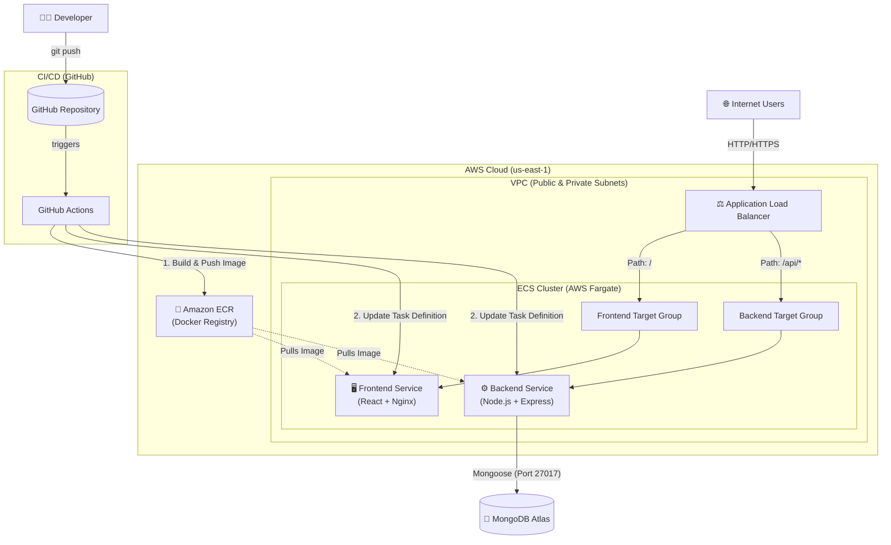

# Smart Campus Entry Monitoring System

A full-stack web application for real-time monitoring of student entry and exit at a college campus gate. Built with the MERN stack, the system supports biometric terminal-based access events as a primary automated channel and SAP ID based manual entry as an operational fallback, automatically toggles between entry and exit states, tracks day scholars and hostellers separately, detects curfew violations, supports hosteller exit-request approvals, enables student enrollment via Excel upload, sends parent notifications via email and SMS, and provides role-aware dashboards with rich analytics.

> **Academic Project** -- 3rd Year, BTech Computer Science

---

## Quick Start

```bash
# 1. Make sure MongoDB is running locally (mongod)

# 2. Install dependencies
cd backend && npm install
cd ../frontend && npm install

# 3. Configure secrets (the server refuses to start without them)
cd ../backend
cp .env.example .env
#    set MONGO_URI, JWT_SECRET (32+ chars) and TEMPLATE_ENC_KEY:
node -e "console.log(require('crypto').randomBytes(32).toString('hex'))"

# 4. Reset student data
npm run seed

# 5. Start the backend (Terminal 1)
npm run dev
# → API running at http://localhost:5000

# 6. Start the frontend (Terminal 2)
cd ../frontend
npm run dev
# → App running at http://localhost:5173

# 7. Open http://localhost:5173 in your browser
#    Login: admin / admin123  (or  security1 / security123)
```

---

## Table of Contents

1. [Quick Start](#quick-start)
2. [System Architecture](#system-architecture)
3. [Tech Stack](#tech-stack)
4. [Features](#features)
5. [Database Schema](#database-schema)
6. [API Endpoints](#api-endpoints)
7. [Project Structure](#project-structure)
8. [Installation and Setup](#installation-and-setup)
9. [Environment Variables](#environment-variables)
10. [Seed Data](#seed-data)
11. [Use Case Diagram](#use-case-diagram)
12. [Scan Logic Flowchart](#scan-logic-flowchart)
13. [Screenshots](#screenshots)
14. [Future Scope](#future-scope)
15. [Authors](#authors)
16. [License](#license)
17. [Terminal Sync (eSSL X990, ADMS push)](#terminal-sync-essl-x990-adms-push)

---

## System Architecture

```
+---------------------------------------------------------------------+
|                          CLIENT  (Browser)                          |
|                                                                     |
|   +------------------+    +-------------------+    +--------------+ |
|   | React (Vite)     |    | Manual SAP Input  |    | Chart.js     | |
|   | React Router DOM |    | Live Gate Control |    | Analytics    | |
|   | Tailwind CSS     |    |                   |    |              | |
|   | Axios HTTP       |    |                   |    |              | |
|   +--------+---------+    +--------+----------+    +------+-------+ |
|            |                       |                      |         |
+------------|--------- -------------|----------------------|---------+
             |  REST API  (JSON)     |                      |
             v                       v                      v
+---------------------------------------------------------------------+
|                        BACKEND  (Node.js)                           |
|                                                                     |
|   +------------------+    +-------------------+    +--------------+ |
|   | Express.js       |    | JWT Auth          |    | Notification | |
|   | REST API Routes  |    | Middleware        |    | Service      | |
|   | Controllers      |    | Role-based Access |    |              | |
|   +--------+---------+    +-------------------+    +---+-----+---+ |
|            |                                           |           |
|            |           +-------------------+           |           |
|            +---------->| Mongoose ODM      |           |           |
|                        | Models & Schemas  |           |           |
|                        +--------+----------+           |           |
|                                 |                      |           |
+---------------------------------------------------------------------+
                                  |                      |     
                                  v                      v     
                          +---------------+           +------+ 
                          |   MongoDB     |           |SMTP  | 
                          |   Database    |           |Gmail |
                          +---------------+           +------+ 
```

---

## Tech Stack

### Backend

| Technology         | Purpose                                    |
| ------------------ | ------------------------------------------ |
| Node.js            | Server-side JavaScript runtime             |
| Express.js 4.x     | Web framework and REST API routing          |
| MongoDB            | NoSQL document database                    |
| Mongoose 8.x       | MongoDB ODM with schema validation         |
| JSON Web Tokens    | Stateless authentication (Bearer tokens)   |
| bcryptjs           | Password hashing (12 salt rounds)          |
| Nodemailer         | SMTP email delivery to parents             |
| Fast2SMS API       | SMS notifications (India)                  |
| Helmet             | HTTP security headers                      |
| express-rate-limit | API rate limiting (200 req / 15 min)       |
| Morgan             | HTTP request logging (dev mode)            |
| express-validator  | Request body validation                    |
| dotenv             | Environment variable management            |
| socket.io          | Real-time event broadcasting from backend  |
| node-zklib         | Biometric terminal integration support     |

### Frontend

| Technology         | Purpose                                    |
| ------------------ | ------------------------------------------ |
| React 18           | Component-based UI library                 |
| Vite 5             | Fast development server and build tool     |
| React Router DOM 6 | Client-side routing with protected routes  |
| Tailwind CSS 3     | Utility-first CSS framework                |
| Axios              | HTTP client with interceptors              |
| Chart.js 4         | Bar, Line, and Doughnut chart rendering    |
| react-chartjs-2    | React wrapper for Chart.js                 |
| react-hot-toast    | Toast notification popups                  |
| react-icons        | Icon library (Heroicons outline set)       |
| socket.io-client   | Live updates for alerts, ticker, and status |

---

## Features

### Core Functionality

- **Biometric Terminal Processing** -- Fingerprint devices submit scan events to the backend using authenticated terminal payloads (`deviceSN`, `machineNumber`, `userId`) for real-time entry/exit decisions.
- **SAP ID Manual Entry Workflow** -- Gate staff records student movement by entering SAP ID in the scanning dashboard. This is the supported manual fallback/override flow alongside biometric terminal ingestion.
- **Entry and Exit Logging from One Dashboard** -- The same scanning dashboard handles both entry and exit actions by evaluating each student's latest state.
- **Smart Entry/Exit Toggle** -- The system automatically determines whether an SAP ID action is an entry or exit based on the student's current state for the day:
  - No log today --> **ENTRY**
  - Currently status `entered` --> **EXIT**
  - Currently status `exited` --> **RE-ENTRY** (new log)
- **Unauthorized Attempt Detection** -- SAP IDs not matching any active student record are logged as unauthorized attempts with timestamp and date.
- **Visitor Entry Capture** -- Security can also register visitor entries from the same operational page with identity and meeting details.

### Biometric Access and Terminal Operations

- **Terminal Authentication** -- Every biometric event is validated against registered terminal identity (`machineNumber` + `deviceSN`) before access is considered.
- **Live Terminal Health (Heartbeat)** -- Devices post heartbeat updates to keep terminal online/offline status current in the admin terminal dashboard.
- **Blocked Student Enforcement** -- Blocked students are denied biometric access, logged in access-control audit trails, and surfaced in alert feeds.
- **Warden Approval Enforcement for Hostellers** -- For students requiring warden authorization, biometric exit/entry is gated by approved and active request windows.
- **Enrollment Station Mode** -- Dedicated enrollment terminals are recognized separately and excluded from gate-movement logging.
- **Real-time Security Events** -- Authorized scans, unauthorized attempts, blocked attempts, warden-required events, and terminal online events are broadcast live via sockets.

### Student Management

- **Day Scholar / Hosteller Classification** -- Every student record has a `category` field distinguishing between day scholars and hostellers.
- **CRUD Operations** -- Admin users can create, read, update, and soft-delete (deactivate) student records.
- **Search and Filter** -- Students can be searched by name or SAP ID and filtered by category.
- **Excel Enrollment Upload** -- Admin can bulk upload students via `.xlsx/.xls` with automatic extraction, row-wise validation, category normalization, and database insertion.
- **Resilient Bulk Insert** -- Valid rows are inserted even when some rows fail; upload results include success count, failure count, and row-level error reasons.
- **Category-aware Field Mapping** -- Upload processing automatically assigns hosteller/day scholar defaults (including hostel and approval-related fields) based on the submitted category.

### Hosteller Monitoring

- **Curfew Violation Detection** -- If a hosteller exits after the configured curfew hour (default 22:00), the log is flagged with `lateReturn: true`.
- **Live Hosteller Status Table** -- Dedicated page showing each hosteller's current status (Inside Campus / Outside / No Activity), last scan time, and late-return alerts.
- **Filter Tabs** -- Quick filters for All, Outside, Late Return, and No Activity hostellers.
- **Auto-refresh** -- Hosteller data refreshes automatically every 30 seconds.

### Parent Notifications

- **Email Notifications** -- HTML-formatted entry/exit emails sent to the parent's registered email address via SMTP (Nodemailer).
- **SMS Notifications** -- Plain-text SMS sent via the Fast2SMS bulk API to the parent's registered phone number.
- **Fire-and-Forget** -- Notifications are dispatched asynchronously; scan response is not blocked.
- **Manual Trigger** -- Admin can manually trigger a notification via the `/api/notify` endpoint.

### Admin Dashboard

- **Real-time Statistics** -- Total students, currently inside campus, entries today, exits today, unauthorized attempts, hostellers outside, and late returns.
- **Hourly Entry/Exit Distribution** -- Bar chart showing entries and exits for each hour of the day.
- **7-Day Attendance Trend** -- Line chart plotting unique students and total scans over the past week.
- **Campus Population Curve** -- Area chart simulating the campus population throughout the day (cumulative entries minus exits).
- **Student Category Doughnut** -- Doughnut chart breaking down day scholars vs hostellers.
- **Peak Entry Hours** -- Top 5 busiest entry hours displayed as badges.
- **Date Selector** -- Analytics page allows picking any date to view historical hourly distribution.
- **Auto-refresh** -- Dashboard data refreshes every 30 seconds.

### Authentication and Authorization

- **JWT Authentication** -- Login returns a signed Bearer token stored in `localStorage`.
- **Role-based Access Control** -- Multiple roles are supported, including `admin`, `security`, and `warden`, each with feature-level route permissions.
- **Token Validation Middleware** -- All API routes except login are protected. Invalid/expired tokens trigger a 401 and automatic redirect to login.
- **Global 401 Interceptor** -- Axios response interceptor clears stored credentials and redirects to `/login` on any 401 response.
- **Dedicated Student Authentication Flow** -- Hosteller request APIs support student-side authentication for creating and tracking exit requests.

### Security

- **Helmet** -- Sets secure HTTP headers (Content-Security-Policy, X-Frame-Options, etc.).
- **CORS** -- Restricted to the configured `CLIENT_URL` origin.
- **Rate Limiting** -- 200 requests per 15-minute window per IP on all `/api/` routes.
- **Password Hashing** -- bcrypt with 12 salt rounds; passwords stored hashed, never in plain text.
- **Soft Delete** -- Students are deactivated (`isActive: false`) rather than permanently deleted.

### UI/UX

- **Responsive Layout** -- Desktop sidebar collapses into a mobile hamburger drawer.
- **Toast Notifications** -- Instant feedback on scan success, errors, and unauthorized attempts.
- **Processing Cooldown** -- 2-second debounce between scans to prevent duplicate processing.
- **Loading States** -- Animated spinners during data fetching.
- **Paginated Tables** -- Entry logs and student lists support server-side pagination.
- **Role-aware Navigation** -- Sidebar links are filtered dynamically based on authenticated user role.
- **Real-time Status Banner and Ticker** -- Socket-powered indicators show connection status and live event updates.

### Web Pages and Modules

- **Login Page (`/login`)** -- Authenticates staff users and issues role-based access to protected modules.
- **Dashboard (`/dashboard`)** -- Primary operational overview with counts, trend snapshots, and current campus occupancy.
- **Gate Scanner (`/scanner`)** -- SAP ID manual entry page for recording entry/exit and handling unauthorized attempts; also includes visitor entry capture and complements biometric terminal operations.
- **Entry Logs (`/logs`)** -- Filterable and paginated movement history with unauthorized log review workflow.
- **Analytics (`/analytics`)** -- Historical and comparative visual analytics for movement, occupancy, and category split.
- **Hostellers (`/hostellers`)** -- Monitors hostel students, active/late states, and operational hostel status.
- **Student Management (`/admin/students`)** -- Full student lifecycle management, including manual create/update and Excel bulk enrollment upload.
- **Enrollment (`/admin/enrollment`)** -- Enrollment lifecycle management and student-type mapping controls.
- **Access Control (`/admin/access-control`)** -- Block/unblock operations with reasons and per-student access audit logs.
- **Warden Portal (`/admin/warden-portal`)** -- Reviews and acts on hosteller exit requests with approval/rejection actions.
- **Terminals (`/admin/terminals`)** -- Biometric terminal registration, assignment, health/status visibility, per-terminal activity, and configuration management.
- **Settings (`/admin/settings`)** -- System-level settings management, including security and operational configuration.
- **Public Live Dashboard (`/live`)** -- Public-facing, read-only live campus status view.
- **Student Exit Request (`/student/exit-request`)** -- Student-facing page to authenticate and submit hosteller exit requests.

### Page Flow (Operational)

- **Staff flow** -- Login -> Dashboard -> Gate Scanner (SAP ID entry) -> Entry Logs / Analytics -> module-specific admin pages.
- **Admin flow** -- Login -> Student Management (manual or Excel upload) -> Enrollment / Access Control / Terminals / Settings.
- **Warden flow** -- Login -> Warden Portal -> approve/reject requests -> Hostellers dashboard review.
- **Student flow** -- Student Exit Request page -> request submission -> status checks via public/student endpoints -> approved movement reflected in logs.
- **Biometric device flow** -- Fingerprint terminal scan -> `/api/fingerprint/scan` validation -> entry/exit decision -> log/alert/socket updates -> optional parent notification.

---

## Database Schema

### `admins` Collection

| Field      | Type     | Constraints                         | Description                         |
| ---------- | -------- | ----------------------------------- | ----------------------------------- |
| `username` | String   | required, unique, trimmed           | Login username                      |
| `password` | String   | required, minlength 6, select:false | Bcrypt-hashed password              |
| `name`     | String   | required, trimmed                   | Display name                        |
| `role`     | String   | enum: `admin`, `security`           | Role for authorization              |
| `createdAt`| Date     | auto (timestamps)                   | Record creation timestamp           |
| `updatedAt`| Date     | auto (timestamps)                   | Record update timestamp             |

**Pre-save Hook:** Hashes `password` with bcrypt (12 rounds) before saving.
**Instance Method:** `comparePassword(candidate)` returns a boolean.

### `students` Collection

| Field         | Type    | Constraints                              | Description                          |
| ------------- | ------- | ---------------------------------------- | ------------------------------------ |
| `sapId`       | String  | required, unique, trimmed, indexed       | Student SAP identification number    |
| `name`        | String  | required, trimmed                        | Full name of the student             |
| `email`       | String  | required, trimmed, lowercase             | Student email address                |
| `parentEmail` | String  | trimmed, lowercase                       | Parent/guardian email for alerts      |
| `parentPhone` | String  | trimmed                                  | Parent/guardian phone for SMS         |
| `category`    | String  | required, enum: `day_scholar`, `hosteller` | Student residential category       |
| `department`  | String  | trimmed                                  | Academic department                  |
| `year`        | Number  | min 1, max 5                             | Current year of study                |
| `photoUrl`    | String  | default: `""`                            | URL to student photo                 |
| `isActive`    | Boolean | default: `true`                          | Soft-delete flag                     |
| `createdAt`   | Date    | auto (timestamps)                        | Record creation timestamp            |
| `updatedAt`   | Date    | auto (timestamps)                        | Record update timestamp              |

### `entrylogs` Collection

| Field         | Type   | Constraints                              | Description                                |
| ------------- | ------ | ---------------------------------------- | ------------------------------------------ |
| `sapId`       | String | required, indexed                        | Student SAP ID (foreign reference)         |
| `studentName` | String | required                                 | Denormalized student name                  |
| `category`    | String | enum: `day_scholar`, `hosteller`         | Denormalized student category              |
| `date`        | String | required, indexed (YYYY-MM-DD)           | Calendar date of the log                   |
| `entryTime`   | Date   | default: null                            | Timestamp of campus entry                  |
| `exitTime`    | Date   | default: null                            | Timestamp of campus exit                   |
| `status`      | String | enum: `entered`, `exited`                | Current state of this log record           |
| `lateReturn`  | Boolean| default: false                           | Whether this was a curfew violation        |
| `createdAt`   | Date   | auto (timestamps)                        | Record creation timestamp                  |
| `updatedAt`   | Date   | auto (timestamps)                        | Record update timestamp                    |

**Compound Index:** `{ sapId: 1, date: 1 }` for fast lookups.

### `unauthorizedlogs` Collection

| Field          | Type    | Constraints            | Description                              |
| -------------- | ------- | ---------------------- | ---------------------------------------- |
| `scannedValue` | String  | required               | The unrecognized SAP ID input            |
| `date`         | String  | required (YYYY-MM-DD)  | Calendar date of the attempt             |
| `timestamp`    | Date    | default: Date.now      | Exact timestamp of the SAP ID attempt    |
| `resolved`     | Boolean | default: false         | Whether admin has reviewed this incident |
| `notes`        | String  | default: `""`          | Admin notes upon resolution              |
| `createdAt`    | Date    | auto (timestamps)      | Record creation timestamp                |
| `updatedAt`    | Date    | auto (timestamps)      | Record update timestamp                  |

---

## API Endpoints

All endpoints are prefixed with `/api`. Endpoints marked with a lock require a valid JWT Bearer token in the `Authorization` header. Endpoints marked with **(admin)** additionally require the `admin` role.

### Authentication

| Method | Endpoint             | Auth       | Description                                  |
| ------ | -------------------- | ---------- | -------------------------------------------- |
| POST   | `/api/auth/login`    | Public     | Login with username/password; returns JWT     |
| GET    | `/api/auth/me`       | Protected  | Get current authenticated user profile        |
| POST   | `/api/auth/register` | Admin only | Register a new staff user (admin/security/warden) |
| GET    | `/api/auth/staff`    | Admin only | List staff users and roles                     |
| PUT    | `/api/auth/staff/:id`| Admin only | Update staff profile/role                      |
| DELETE | `/api/auth/staff/:id`| Admin only | Remove/deactivate a staff user                 |

### Scan Processing

| Method | Endpoint     | Auth      | Description                                                     |
| ------ | ------------ | --------- | --------------------------------------------------------------- |
| POST   | `/api/scan`  | Protected | Process SAP ID manual entry; auto-detects entry/exit/re-entry   |
| POST   | `/api/fingerprint/scan` | Device/API | Process biometric terminal scan with terminal authentication and policy checks |
| POST   | `/api/fingerprint/heartbeat` | Device/API | Update terminal liveness and last-seen status |

**Request Body:** `{ "sapId": "500091001" }`
**Success Response:** `{ authorized, action, student, log }`
**Unauthorized Response (404):** `{ authorized: false, message, scannedValue }`

### Students

| Method | Endpoint                | Auth       | Description                                 |
| ------ | ----------------------- | ---------- | ------------------------------------------- |
| GET    | `/api/students`         | Protected  | List students (supports `?category`, `?search`, `?page`, `?limit`) |
| GET    | `/api/students/:sapId`  | Protected  | Get a single student by SAP ID              |
| POST   | `/api/students`         | Admin only | Create a new student record                 |
| POST   | `/api/students/upload`  | Admin only | Bulk upload students via Excel (`.xlsx/.xls`) |
| PUT    | `/api/students/:sapId`  | Admin only | Update a student record                     |
| DELETE | `/api/students/:sapId`  | Admin only | Soft-delete (deactivate) a student          |

### Entry Logs

| Method | Endpoint                              | Auth      | Description                                        |
| ------ | ------------------------------------- | --------- | -------------------------------------------------- |
| GET    | `/api/logs`                           | Protected | List entry logs (supports `?date`, `?sapId`, `?category`, `?status`, `?page`, `?limit`) |
| GET    | `/api/logs/unauthorized`              | Protected | List unauthorized scan logs (supports `?date`, `?resolved`, `?page`, `?limit`) |
| PUT    | `/api/logs/unauthorized/:id/resolve`  | Protected | Mark an unauthorized log as resolved               |

### Dashboard & Analytics

| Method | Endpoint                  | Auth      | Description                                         |
| ------ | ------------------------- | --------- | --------------------------------------------------- |
| GET    | `/api/dashboard`          | Protected | Aggregated stats: totals, today counts, weekly trend |
| GET    | `/api/dashboard/hourly`   | Protected | Hourly entry/exit distribution (supports `?date`)    |
| GET    | `/api/dashboard/hostellers` | Protected | Current status of all hostellers                   |

### Notifications

| Method | Endpoint       | Auth      | Description                                         |
| ------ | -------------- | --------- | --------------------------------------------------- |
| POST   | `/api/notify`  | Protected | Manually trigger parent notification for a student   |

**Request Body:** `{ "sapId": "500091001", "action": "entry" }`

### Visitors

| Method | Endpoint        | Auth      | Description                                     |
| ------ | --------------- | --------- | ----------------------------------------------- |
| GET    | `/api/visitors` | Protected | List recent visitor entries                      |
| POST   | `/api/visitors` | Protected | Record a visitor entry from gate operations      |

### Enrollment

| Method | Endpoint                                 | Auth       | Description                                  |
| ------ | ---------------------------------------- | ---------- | -------------------------------------------- |
| POST   | `/api/enrollment/initiate/:studentId`    | Admin only | Start enrollment workflow for a student       |
| POST   | `/api/enrollment/confirm/:studentId`     | Admin only | Confirm enrollment with student type details  |
| PUT    | `/api/enrollment/update-type/:studentId` | Admin only | Update hosteller/day scholar mapping          |
| GET    | `/api/enrollment/stats`                  | Admin only | Enrollment statistics summary                  |

### Access Control

| Method | Endpoint                           | Auth                  | Description                              |
| ------ | ---------------------------------- | --------------------- | ---------------------------------------- |
| POST   | `/api/access/block/:studentId`     | Admin only            | Block student access with reason         |
| POST   | `/api/access/unblock/:studentId`   | Admin only            | Unblock student access with reason       |
| GET    | `/api/access/blocked`              | Admin, Security       | List blocked students                    |
| GET    | `/api/access/log/:studentId`       | Admin, Security       | Get access-control audit trail           |

### Hosteller Exit Requests

| Method | Endpoint                               | Auth                 | Description                                      |
| ------ | -------------------------------------- | -------------------- | ------------------------------------------------ |
| POST   | `/api/hosteller/student/login`         | Public (student auth)| Student login for request workflows              |
| POST   | `/api/hosteller/request`               | Public (student auth)| Create hosteller exit request                    |
| GET    | `/api/hosteller/public/:sapId`         | Public               | Public request status lookup by SAP ID           |
| GET    | `/api/hosteller/requests`              | Admin, Warden        | List all requests                                |
| POST   | `/api/hosteller/approve/:requestId`    | Admin, Warden        | Approve request                                  |
| POST   | `/api/hosteller/reject/:requestId`     | Admin, Warden        | Reject request with reason                       |
| GET    | `/api/hosteller/active`                | Admin, Warden        | List active approved requests                    |
| GET    | `/api/hosteller/history/:studentId`    | Admin, Warden        | Student request history                           |
| GET    | `/api/hosteller/hostel/:hostelId`      | Admin, Warden        | Hostel-wise request view                          |

### Hostels

| Method | Endpoint                       | Auth          | Description                              |
| ------ | ------------------------------ | ------------- | ---------------------------------------- |
| GET    | `/api/hostels`                 | Admin, Warden | List hostels                              |
| GET    | `/api/hostels/:hostelId`       | Admin, Warden | Get hostel details                        |
| GET    | `/api/hostels/:hostelId/rooms` | Admin, Warden | Get room-level summary                    |
| POST   | `/api/hostels`                 | Admin only    | Create hostel                             |
| PUT    | `/api/hostels/:hostelId`       | Admin only    | Update hostel                             |
| DELETE | `/api/hostels/:hostelId`       | Admin only    | Delete hostel                             |

### Terminals

| Method | Endpoint                                  | Auth                   | Description                                   |
| ------ | ----------------------------------------- | ---------------------- | --------------------------------------------- |
| GET    | `/api/terminals`                          | Admin, Security        | List terminal configurations                   |
| GET    | `/api/terminals/status`                   | Admin, Security, Warden| Live terminal status and heartbeat insights    |
| GET    | `/api/terminals/:terminalId`              | Admin, Security        | Get terminal details                           |
| POST   | `/api/terminals`                          | Admin only             | Register a terminal                            |
| PUT    | `/api/terminals/:terminalId`              | Admin only             | Update terminal config                         |
| DELETE | `/api/terminals/:terminalId`              | Admin only             | Remove terminal                                |

### Alerts

| Method | Endpoint            | Auth                     | Description                              |
| ------ | ------------------- | ------------------------ | ---------------------------------------- |
| GET    | `/api/alerts`       | Admin, Warden, Security  | List alert feed                           |
| POST   | `/api/alerts`       | Admin, Warden, Security  | Create/raise operational alert            |

### Fingerprint Device Integration

| Method | Endpoint                     | Auth      | Description                                  |
| ------ | ---------------------------- | --------- | -------------------------------------------- |
| POST   | `/api/fingerprint/scan`      | Device/API| Ingest fingerprint events, validate terminal identity, enforce access rules, and trigger live updates |
| POST   | `/api/fingerprint/heartbeat` | Device/API| Ingest terminal heartbeat and maintain online/offline telemetry |

### Live Public Data

| Method | Endpoint       | Auth   | Description                                 |
| ------ | -------------- | ------ | ------------------------------------------- |
| GET    | `/api/live`    | Public | Public live dashboard payload               |

### System Settings

| Method | Endpoint                      | Auth        | Description                                  |
| ------ | ----------------------------- | ----------- | -------------------------------------------- |
| GET    | `/api/settings`               | Admin only  | Get configurable system settings              |
| POST   | `/api/settings`               | Admin only  | Create/update settings set                    |
| GET    | `/api/settings/security`      | Admin only  | Get security policy settings                  |
| PUT    | `/api/settings/security`      | Admin only  | Update security policy settings               |

### Utility

| Method | Endpoint       | Auth   | Description                            |
| ------ | -------------- | ------ | -------------------------------------- |
| GET    | `/api/health`  | Public | Health check; returns `{ status: "ok" }` |

---

## Project Structure

```
smart-campus-monitor/
|
+-- .gitignore
+-- README.md
|
+-- backend/
|   +-- .env.example              # Environment variable template
|   +-- package.json              # Backend dependencies and scripts
|   +-- server.js                 # Express app entry point
|   |
|   +-- config/
|   |   +-- db.js                 # MongoDB connection (Mongoose)
|   |
|   +-- middleware/
|   |   +-- auth.js               # JWT protect + role-based authorize
|   |   +-- errorHandler.js       # Centralized error handler
|   |
|   +-- models/
|   |   +-- Admin.js              # Admin/security user schema
|   |   +-- Student.js            # Student schema
|   |   +-- EntryLog.js           # Entry/exit log schema
|   |   +-- UnauthorizedLog.js    # Unauthorized scan log schema
|   |   +-- HostellerRequest.js   # Hosteller exit request schema
|   |   +-- TerminalConfig.js     # Terminal configuration schema
|   |   +-- AccessControlLog.js   # Access block/unblock audit schema
|   |
|   +-- controllers/
|   |   +-- authController.js     # Login, register, getMe
|   |   +-- scanController.js     # SAP ID entry/exit processing logic
|   |   +-- studentController.js  # Student CRUD operations
|   |   +-- logController.js      # Entry log and unauthorized log queries
|   |   +-- dashboardController.js # Dashboard aggregation queries
|   |   +-- enrollmentController.js # Enrollment workflow
|   |   +-- accessController.js   # Access control operations
|   |   +-- hostellerController.js # Exit request workflow
|   |
|   +-- routes/
|   |   +-- auth.js               # /api/auth routes
|   |   +-- scan.js               # /api/scan routes
|   |   +-- students.js           # /api/students routes
|   |   +-- logs.js               # /api/logs routes
|   |   +-- dashboard.js          # /api/dashboard routes
|   |   +-- notify.js             # /api/notify routes
|   |   +-- enrollment.js         # /api/enrollment routes
|   |   +-- access.js             # /api/access routes
|   |   +-- hosteller.js          # /api/hosteller routes
|   |   +-- terminals.js          # /api/terminals routes
|   |   +-- hostels.js            # /api/hostels routes
|   |   +-- visitors.js           # /api/visitors routes
|   |   +-- live.js               # /api/live routes
|   |   +-- settings.js           # /api/settings routes
|   |
|   +-- services/
|   |   +-- notification.js       # Email (Nodemailer) + SMS (Fast2SMS)
|   |
|   +-- utils/
|       +-- seed.js               # Database seed script
|
+-- frontend/
    +-- package.json              # Frontend dependencies and scripts
    +-- index.html                # HTML entry point
    +-- vite.config.js            # Vite config with API proxy
    +-- tailwind.config.js        # Tailwind CSS configuration
    +-- postcss.config.js         # PostCSS plugins
    |
    +-- src/
        +-- main.jsx              # React DOM render entry point
        +-- index.css             # Global styles and Tailwind directives
        +-- App.jsx               # Root component with routes
        |
        +-- context/
        |   +-- AuthContext.jsx    # Authentication context provider
        |
        +-- services/
        |   +-- api.js            # Axios instance and API functions
        |
        +-- components/
        |   +-- Layout.jsx        # Sidebar + top bar + Outlet
        |   +-- ExcelUploadModal.jsx # Bulk enrollment upload modal
        |   +-- LiveScanTicker.jsx # Live bottom ticker for recent activity
        |   +-- AlertBell.jsx     # Alert center shortcut
        |   +-- StatCard.jsx      # Reusable statistic card
        |
        +-- pages/
            +-- Login.jsx         # Login page
            +-- Dashboard.jsx     # Dashboard with stat cards and charts
            +-- Scanner.jsx       # Gate scanner with SAP ID manual input
            +-- StudentLogs.jsx   # Paginated entry/exit log table
            +-- Analytics.jsx     # Analytics charts (doughnut, bar, line)
            +-- Hostellers.jsx    # Hosteller monitoring table
            +-- StudentManagement.jsx # Student CRUD + Excel upload
            +-- Enrollment.jsx    # Enrollment workflow dashboard
            +-- AccessControl.jsx # Block/unblock and access history
            +-- WardenPortal.jsx  # Hosteller request approvals
            +-- Terminals.jsx     # Terminal management and status
            +-- PublicLiveDashboard.jsx # Public live status view
            +-- StudentExitRequest.jsx # Student-facing exit request form
            +-- Settings.jsx      # Application settings page
```

---

## Installation and Setup

### Prerequisites

- **Node.js** >= 18.x ([https://nodejs.org](https://nodejs.org))
- **MongoDB** >= 6.x running locally or a MongoDB Atlas connection URI
- **Git** (optional, for cloning)
- A modern web browser (Chrome, Edge, or Firefox recommended)

### Step 1 -- Clone the Repository

```bash
git clone <repository-url>
cd smart-campus-monitor
```

### Step 2 -- Backend Setup

```bash
cd backend
npm install
```

Create the environment file by copying the template:

```bash
cp .env.example .env
```

Edit `.env` and fill in your values (see [Environment Variables](#environment-variables) below).

### Step 3 -- Frontend Setup

Open a new terminal:

```bash
cd frontend
npm install
```

### Step 4 -- Start MongoDB

If using a local MongoDB instance:

```bash
mongod
```

Or update `MONGO_URI` in `.env` with your MongoDB Atlas connection string.

### Step 5 -- Seed Students

From the `backend/` directory:

```bash
npm run seed
```

This will:
- Clear the students collection only
- Insert 14 sample students (SAP IDs 70552000002--70552000014 and 70552300067)
- Keep existing admins, hostels, and settings unchanged
- Add an `entered` log for each hosteller for today if needed (does not clear existing logs)
- Require hostels with codes `BHA` and `GHB` to already exist

### Step 6 -- Start the Backend Server

```bash
cd backend
npm run dev
```

The API server will start on **http://localhost:5000**.

### Step 7 -- Start the Frontend Dev Server

```bash
cd frontend
npm run dev
```

The React app will start on **http://localhost:5173**.
The Vite dev server proxies all `/api` requests to `http://localhost:5000`.

### Step 8 -- Open the Application

Navigate to **http://localhost:5173** in your browser.

**Default login credentials:**

| Role     | Username    | Password      |
| -------- | ----------- | ------------- |
| Admin    | `admin`     | `admin123`    |
| Security | `security1` | `security123` |

---

## Environment Variables

Create a `.env` file in the `backend/` directory (a template is provided in `.env.example`):

```env
# Server
PORT=5000                              # Port for the Express server
NODE_ENV=development                   # Environment mode (development / production)

# MongoDB
MONGO_URI=mongodb://localhost:27017/smart_campus   # MongoDB connection string

# JWT Authentication
JWT_SECRET=change_this_to_a_long_random_string     # Secret key for signing JWT tokens
JWT_EXPIRES_IN=7d                                  # Token expiration duration

# Email Notifications (Nodemailer via SMTP)
SMTP_HOST=smtp.gmail.com               # SMTP server host
SMTP_PORT=587                          # SMTP server port (587 for TLS)
SMTP_USER=your_email@gmail.com         # SMTP authentication username
SMTP_PASS=your_app_password            # SMTP authentication password (use App Password for Gmail)
EMAIL_FROM=Smart Campus <noreply@smartcampus.edu>  # Sender display name and email

# SMS Notifications (Fast2SMS - India)
FAST2SMS_API_KEY=your_fast2sms_api_key  # API key from fast2sms.com dashboard

# Hosteller Curfew
CURFEW_HOUR=22                         # Hour (24h format) after which exits are flagged as late

# CORS
CLIENT_URL=http://localhost:5173       # Allowed origin for CORS (frontend URL)
```

| Variable         | Required | Description                                                                 |
| ---------------- | -------- | --------------------------------------------------------------------------- |
| `PORT`           | No       | Defaults to `5000`                                                          |
| `NODE_ENV`       | No       | Defaults to `development`; set `production` to disable Morgan logging       |
| `MONGO_URI`      | Yes      | Full MongoDB connection URI                                                 |
| `JWT_SECRET`     | Yes      | Must be a long, random, unpredictable string                                |
| `JWT_EXPIRES_IN` | No       | Defaults to `7d`; accepts values like `1h`, `30d`, etc.                     |
| `SMTP_HOST`      | No*      | Required only if email notifications are desired                            |
| `SMTP_PORT`      | No*      | Required only if email notifications are desired                            |
| `SMTP_USER`      | No*      | Required only if email notifications are desired                            |
| `SMTP_PASS`      | No*      | For Gmail, use an App Password (not your account password)                  |
| `EMAIL_FROM`     | No*      | Display name and email for the From header                                  |
| `FAST2SMS_API_KEY` | No*    | Required only if SMS notifications are desired; obtain from fast2sms.com    |
| `CURFEW_HOUR`    | No       | Defaults to `22` (10:00 PM); exits after this hour flag `lateReturn: true`  |
| `CLIENT_URL`     | No       | Defaults to `http://localhost:5173`; update for production deployments      |


---

## Seed Data (Students Only)

Run the seed script from the `backend/` directory:

```bash
npm run seed
```

### Seeded Students (14 records)

| SAP ID      | Name            | Category    | Course        | Department          | Year |
| ----------- | --------------- | ----------- | ------------- | ------------------- | ---- |
| 70552300067 | Sanket Mali     | Day Scholar | Engineering   | Computer Science    | 3    |
| 70552000002 | Aarav Sharma    | Day Scholar | Engineering   | Computer Science    | 3    |
| 70552000003 | Priya Patel     | Day Scholar | Pharmacy      | BPharm              | 2    |
| 70552000004 | Vikram Singh    | Day Scholar | Engineering   | Computer Engineering | 2    |
| 70552000005 | Karthik Nair    | Day Scholar | MBATech       | MBATech             | 1    |
| 70552000006 | Arjun Desai     | Day Scholar | Pharmacy      | BPharm              | 4    |
| 70552000007 | Divya Kulkarni  | Day Scholar | Engineering   | Computer Science    | 3    |
| 70552000008 | Rohan Gupta     | Hosteller   | Engineering   | Computer Engineering | 2    |
| 70552000009 | Aditya Verma    | Hosteller   | Engineering   | Computer Engineering | 1    |
| 70552000010 | Rahul Mehta     | Hosteller   | Engineering   | Computer Engineering | 3    |
| 70552000011 | Sneha Reddy     | Hosteller   | Pharmatech    | Pharmatech          | 4    |
| 70552000012 | Ananya Iyer     | Hosteller   | Pharmacy      | BPharm              | 1    |
| 70552000013 | Meera Joshi     | Hosteller   | Engineering   | Computer Science    | 2    |
| 70552000014 | Ishita Shah     | Hosteller   | Engineering   | Computer Science    | 2    |

**Note:** The seed script does not create or modify admin/staff accounts or hostels. It inserts an `entered` log for each hosteller for today if one does not already exist.

---

## Use Case Diagram

```
                          +-------------------------------+
                          |  Smart Campus Entry Monitor   |
                          +-------------------------------+
                          |                               |
    +----------+          |   +------------------------+  |
    | Security |----------+-->| Enter Student SAP ID   |  |
    |          |----------+-->| Monitor Fingerprint    |  |
    |          |          |   | Terminal Activity      |  |
    | Guard    |          |   +------------------------+  |
    |          |----------+-->| View Scan Result       |  |
    |          |          |   +------------------------+  |
    |          |----------+-->| Manual SAP ID Entry    |  |
    |          |          |   +------------------------+  |
    |          |----------+-->| View Entry Logs        |  |
    |          |          |   +------------------------+  |
    |          |----------+-->| View Dashboard         |  |
    +----------+          |   +------------------------+  |
                          |                               |
    +----------+          |   +------------------------+  |
    | Admin    |----------+-->| All Security actions   |  |
    |          |          |   +------------------------+  |
    |          |----------+-->| Add/Edit/Delete Student|  |
    |          |          |   +------------------------+  |
    |          |----------+-->| Register New Users     |  |
    |          |          |   +------------------------+  |
    |          |----------+-->| View Analytics         |  |
    |          |          |   +------------------------+  |
    |          |----------+-->| Monitor Hostellers     |  |
    |          |          |   +------------------------+  |
    |          |----------+-->| Resolve Unauthorized   |  |
    |          |          |   |   Scan Attempts        |  |
    |          |          |   +------------------------+  |
    |          |----------+-->| Trigger Notifications  |  |
    +----------+          |   +------------------------+  |
                          |                               |
    +----------+          |   +------------------------+  |
    | System   |----------+-->| Auto Entry/Exit Toggle |  |
    | (Auto)   |          |   +------------------------+  |
    |          |----------+-->| Detect Late Return     |  |
    |          |          |   +------------------------+  |
    |          |----------+-->| Log Unauthorized Scans |  |
    |          |          |   +------------------------+  |
    |          |----------+-->| Send Parent Email/SMS  |  |
    +----------+          |   +------------------------+  |
                          |                               |
    +----------+          |   +------------------------+  |
    | Parent   |<---------+---| Receive Email Alert    |  |
    |          |<---------+---| Receive SMS Alert      |  |
    +----------+          |   +------------------------+  |
                          +-------------------------------+
```

---

## Scan Logic Flowchart

```
                    +------------------+
                    | SAP ID Submitted |
                    | (Manual Entry)   |
                    +--------+---------+
                             |
                             v
                   +-------------------+
                   | POST /api/scan    |
                   | { sapId }         |
                   +--------+----------+
                            |
                            v
               +----------------------------+
               | Find Student by sapId      |
               | where isActive = true      |
               +--------+-------------------+
                        |
              +---------+---------+
              |                   |
              v                   v
      +-------+------+   +-------+--------+
      | NOT FOUND    |   | FOUND          |
      +--------------+   +----------------+
              |                   |
              v                   v
   +--------------------+  +--------------------------+
   | Create             |  | Find today's EntryLog    |
   | UnauthorizedLog    |  | for this sapId           |
   +--------------------+  +--------+-----------------+
              |                     |
              v            +--------+--------+-----------+
   +--------------------+  |                 |           |
   | Return 404         |  v                 v           v
   | authorized: false  | +--------+ +----------+ +----------+
   +--------------------+ |No log  | |Status:   | |Status:   |
                          |today   | |entered   | |exited    |
                          +---+----+ +----+-----+ +----+-----+
                              |           |            |
                              v           v            v
                     +----------+ +-----------+ +------------+
                     |Create new| |Set exitTime| |Create new |
                     |EntryLog  | |status=exited| |EntryLog  |
                     |status=   | |Check curfew| |status=    |
                     |entered   | |for hosteller| |entered   |
                     |entryTime | +-----------+ |(re-entry) |
                     |= now     |      |       +------------+
                     +----------+      |            |
                          |            v            |
                          |   +---------------+     |
                          |   |Hour >= CURFEW?|     |
                          |   +---+-------+---+     |
                          |       |       |         |
                          |      Yes      No        |
                          |       |       |         |
                          |       v       |         |
                          | +----------+  |         |
                          | |lateReturn|  |         |
                          | |= true    |  |         |
                          | +----------+  |         |
                          |       |       |         |
                          +---+---+---+---+---------+
                              |       |
                              v       v
                     +---------------------+
                     | action = entry/exit  |
                     +----------+----------+
                                |
                                v
                   +---------------------------+
                   | notifyParent(student,     |
                   |   action, timestamp)      |
                   | (async, fire-and-forget)  |
                   +---------------------------+
                          |             |
                          v             v
                   +-----------+  +-----------+
                   | Send Email|  | Send SMS  |
                   | (SMTP)    |  | (Fast2SMS)|
                   +-----------+  +-----------+
                                |
                                v
                   +---------------------------+
                   | Return JSON response      |
                   | { authorized: true,       |
                   |   action, student, log }  |
                   +---------------------------+

Biometric Terminal Flow (Primary Automated Path):

                    +-----------------------------+
                    | Fingerprint Terminal Event  |
                    | {deviceSN,machine,userId}   |
                    +-------------+---------------+
                                  |
                                  v
                  +-------------------------------------+
                  | POST /api/fingerprint/scan          |
                  | Validate terminal identity          |
                  +----------------+--------------------+
                                   |
                      +------------+------------+
                      |                         |
                      v                         v
            +-------------------+      +-------------------+
            | Invalid terminal  |      | Terminal verified |
            +---------+---------+      +---------+---------+
                      |                          |
                      v                          v
            +-------------------+      +--------------------------+
            | Alert + deny      |      | Resolve student by userId|
            +-------------------+      +------------+-------------+
                                                 |
                                     +-----------+-----------+
                                     |                       |
                                     v                       v
                           +------------------+     +-------------------+
                           | Student not found|     | Student found     |
                           +--------+---------+     +--------+----------+
                                    |                        |
                                    v                        v
                        +------------------------+   +--------------------------+
                        | Unauthorized log/alert |   | Check block + approval   |
                        +------------------------+   +------------+-------------+
                                                              |
                                                  +-----------+-----------+
                                                  |                       |
                                                  v                       v
                                         +-----------------+     +------------------+
                                         | Policy failed   |     | Policy passed    |
                                         | deny + alert    |     | toggle entry/exit|
                                         +-----------------+     +--------+---------+
                                                                           |
                                                                           v
                                                              +-----------------------+
                                                              | Save logs + notify +  |
                                                              | socket live updates   |
                                                              +-----------------------+
```

---

## Complete AWS CI/CD Deployment Guide

A step-by-step, beginner-friendly guide to deploying this MERN stack application to AWS Fargate using a fully automated GitHub Actions CI/CD pipeline.

### System Architecture Diagram




### Step 1: Local Testing & Preparation
Before deploying to the cloud, ensure the app works locally.
1. **Environment Variables:** Create `.env` files in both `frontend` and `backend` using the provided `.env.example` templates.
2. **Run Backend:** `cd backend && npm install && npm run dev`
3. **Run Frontend:** `cd frontend && npm install && npm run dev`
4. **Seed Database:** `cd backend && npm run seed` to insert initial test data.
5. Verify you can log into the local frontend.

### Step 2: Dockerization
The application must be containerized to run on AWS Fargate.
1. **Backend Dockerfile:** Found in `backend/Dockerfile`. It uses a multi-stage Node build, installs dependencies, and exposes Port `5000`.
2. **Frontend Dockerfile:** Found in `frontend/Dockerfile`. It uses Node to build the React Vite app, and then uses Nginx to serve the static files on Port `80`.

### Step 3: AWS Infrastructure Setup
The cloud environment requires a Load Balancer to route traffic.
1. **Application Load Balancer (ALB):** 
   - Go to EC2 -> Load Balancers -> Create ALB.
   - **Crucial:** Enable ALL Availability Zones in the network mapping.
   - Create a Security Group for the ALB allowing HTTP (Port 80) from Anywhere.
2. **Target Groups:**
   - Go to EC2 -> Target Groups.
   - Create `frontend-tg` (Port 80) and `backend-tg` (Port 5000). 
   - **Crucial:** Target Type MUST be **IP addresses** (Required for AWS Fargate).
3. **ALB Listener Rules:**
   - Default Port 80 listener routes to `frontend-tg`.
   - Add a rule: If Path matches `/api/*`, forward to `backend-tg`.

### Step 4: AWS ECS Cluster & Services
This is where your containers actually run.
1. **Cluster:** Create an ECS Cluster named `smart-campus-cluster` using AWS Fargate.
2. **Task Definitions:**
   - Create `smart-campus-backend-task` (Port 5000). Manually add your `MONGO_URI` and `JWT_SECRET` as environment variables here (since `.env` is not pushed to GitHub).
   - Create `smart-campus-frontend-task` (Port 80).
3. **Services:**
   - Create `smart-campus-backend-svc` and `smart-campus-frontend-service` in your cluster.
   - **Crucial:** In the Load Balancing section, attach the ALB and select the correct Target Group. Skipping this causes a 503 error.

### Step 5: IAM User & CI/CD Setup with GitHub Actions
Automate the deployment pipeline so that every push to the `main` branch updates AWS automatically.
1. **Create an IAM User for GitHub:**
   - Go to AWS IAM -> Users -> Create User (e.g., `github-actions-user`).
   - Grant this user permissions to access **ECS** (to update services) and **ECR** (to push Docker images). *Recommendation: Attach `AmazonECS_FullAccess` and `AmazonEC2ContainerRegistryFullAccess` policies.*
   - Generate an **Access Key** for this user (for third-party apps).
2. **GitHub Secrets:** 
   - Go to your GitHub Repository -> Settings -> Secrets and variables -> Actions.
   - Add your newly generated IAM keys as repository secrets: `AWS_ACCESS_KEY_ID` and `AWS_SECRET_ACCESS_KEY`.
3. **Workflow File:** The pipeline is defined in `.github/workflows/deploy.yml`. It uses your IAM credentials to handle:
   - Testing the codebase.
   - Building new Docker images and pushing them to AWS ECR.
   - Fetching the active ECS Task Definition (preserving secrets).
   - Updating the ECS Service with the new image, guaranteeing zero-downtime rolling deployments.

### ⚠️ Common Deployment Mistakes to Avoid
- **MongoDB IP Whitelist:** Fargate uses dynamic IPs. You *must* whitelist `0.0.0.0/0` in MongoDB Atlas, or your backend will crash.
- **Nginx Startup Crash:** Do not hardcode `proxy_pass http://backend:5000;`. Use variables so Nginx resolves it at runtime, otherwise it crashes on boot.
- **CORS Errors:** Do not hardcode API IPs in the frontend `.env.production`. Set `VITE_API_URL=/api`. The ALB will route it seamlessly, completely eliminating CORS.
- **ALB Subnet Mismatch:** If your ALB and ECS Service use different subnets, health checks will fail. Enable all subnets on the ALB.
- **503 Errors:** Always ensure you attach the Target Group when creating your ECS service.

---

## Future Scope

1. **Face Recognition** -- Integrate a face detection model (e.g., face-api.js or a Python microservice with OpenCV/dlib) as an additional identity-verification factor.
2. **Smart ID Wallet Support** -- Generate secure digital student passes (time-bound tokens) in a mobile wallet for assisted gate verification.
3. **Mobile Application** -- Build a React Native or Flutter companion app for security guards to scan on-the-go using the phone camera.
4. **Push Notifications** -- Implement Firebase Cloud Messaging (FCM) for real-time browser and mobile push alerts to parents.
5. **Attendance Integration** -- Connect entry logs with the college LMS or ERP system to auto-mark lecture attendance based on campus presence.
6. **RFID / NFC Support** -- Support RFID card readers or NFC tap at gate turnstiles as an additional input channel.
7. **Geo-fencing** -- Use the browser Geolocation API to verify that scans are performed within the campus premises only.
8. **Multi-gate Support** -- Extend the schema to track which physical gate the student entered/exited from.
9. **Automated Reporting** -- Generate daily/weekly PDF reports summarizing attendance, late returns, and unauthorized attempts, and email them to administrators.
10. **Visitor Management** -- Add a separate workflow for visitor registration, approval, and tracking.
11. **Role Expansion** -- Introduce additional roles such as warden, HOD, and parent (view-only) with granular permissions.
12. **Containerization** -- Dockerize the application with Docker Compose for single-command deployment.
13. **CI/CD Pipeline** -- Set up GitHub Actions for automated testing, linting, and deployment.

---

**Guide / Mentor:**
Prof. Dr. Nitin Choubey
Department of Computer Science and Engineering

---

## License

This project is developed for academic purposes as part of the 3rd Year Computer Science Engineering curriculum. All rights reserved by the authors.

For inquiries regarding reuse or redistribution, contact the authors listed above.

---

<p align="center">
  <strong>Smart Campus Entry Monitoring System</strong><br>
  Built with the MERN Stack<br>
  Node.js &bull; Express &bull; MongoDB &bull; React &bull; Vite &bull; Tailwind CSS
</p>


---

## Terminal Sync (eSSL X990, ADMS push)

Zero-licence sync of users and fingerprint templates to about 90 eSSL X990
(ZKTeco-compatible) terminals. It uses only the open ADMS/iclock push protocol and the
open-source pyzk library. No paid or cracked eSSL software is involved.

> Status: implemented and tested against **simulated** terminals only (fake ADMS terminal,
> fake pyzk device). Nothing here has been measured on an X990 yet. See
> [`smart-campus-monitor/HARDWARE_VERIFICATION.md`](smart-campus-monitor/HARDWARE_VERIFICATION.md)
> and [`smart-campus-monitor/PILOT_CHECKLIST.md`](smart-campus-monitor/PILOT_CHECKLIST.md).

### Architecture

```
                      admin / warden browsers
                                │  HTTPS /api  (JWT, roles)
┌───────────────────────────────▼───────────────────────────────────┐
│ Express backend                                                    │
│  /api/sync (admin API) ─ terminalSyncService ─ TerminalCommand     │
│  /api/fingerprint/scan        │ queue (MongoDB)   │                │
│  /iclock (ADMS listener) ◄────┘                   │ templates:     │
│   cdata / getrequest / devicecmd                  │ AES-256-GCM    │
│  node-cron: ack sweep, nightly reconciliation     │ key from env   │
└─────▲──────────────────────────────────────┬──────┴────────────────┘
      │ terminals dial OUT (HTTP, VLAN only) │ HTTP + shared secret (localhost)
      │ poll every few s, C:<id>:<cmd>       ▼
┌─────┴──────────────┐            ┌───────────────────────┐
│ ~90 X990 terminals │◄── TCP 4370 ─┤ Python pyzk sidecar   │
│ (gate / hostel /   │  bulk loads, │ (FastAPI, internal,   │
│  enrollment)       │  reads, audit│  GPL-2.0 not shipped) │
└────────────────────┘  backups     └───────────────────────┘
```

* **Daily changes** (new student, block, unblock, enrolment fan-out) go through the push
  queue: one command per poll by default, so terminals that are offline catch up when they
  poll again.
* **Bulk first loads, template reads, nightly audits and backups** go through the
  sidecar. It is the only client that opens port 4370.
* **One PIN per student** (`Student.zktUserID`) on every terminal.
* **Software deny stays authoritative.** A blocked student is refused by the scan
  pipeline at once, even before the terminal has processed the delete. A punch by a blocked
  student raises a security alert and queues an immediate delete.

### Flows

| Event | What happens |
|---|---|
| Student added (form or Excel) | status *Awaiting fingerprint*; `USER_CREATE` queued on every enabled gate terminal in the student's groups |
| Enrolment (Enrollment page) | consent check (parental for under-18s) → user record on the enrollment terminal → person enrols on the device menu → template arrives (push upload, or *Fetch template* via sidecar) → stored encrypted → status *Enrolled* → fan-out to target terminals |
| Block (single or bulk) | `USER_DELETE` queued for every enabled terminal (including offline ones); pending creates cancelled |
| Unblock | user + stored templates re-queued (no recapture) |
| Student deactivated / consent withdrawn / "De-enrol & erase" | deletes queued on all terminals; templates erased from MongoDB (DPDP s.8(7)) |
| New terminal | all eligible students queued (or sidecar bulk load above `SYNC_BULK_THRESHOLD`) |
| Nightly (02:20 IST) | per-terminal diff of actual users and desired state; fixes queued; blocked students found on a terminal are deleted and alerted; report stored |

Queue guarantees: commands are persisted in MongoDB, there is at most one open command per
(terminal, student, type) (partial unique index), and a command is resent after 10 minutes
without an ack. After 3 attempts it is marked failed and an alert is raised.

### Setup

1. Backend env: copy `smart-campus-monitor/backend/.env.example`. Required are
   `MONGO_URI`, `JWT_SECRET` and `TEMPLATE_ENC_KEY`. For terminals, also set `ADMS_PORT`,
   `ADMS_HOST` and `ADMS_ALLOWED_CIDRS`, plus `SIDECAR_URL`/`SIDECAR_SECRET` if you use
   the sidecar. The server exits at startup if a required secret is missing.
2. Sidecar: see [`smart-campus-monitor/sidecar/README.md`](smart-campus-monitor/sidecar/README.md).
3. Network: put the terminals on an isolated VLAN. Expose `ADMS_PORT` only on that VLAN or
   a VPN, and allow TCP 4370 only from the sidecar host. Set a comm key on every unit.
   Push has no real authentication (serial number only, plain HTTP unless the X990
   supports TLS), so the only protection is the IP allow-list, the registered-SN check,
   rate limiting and the network isolation.
4. Register each terminal on the **Terminals** page (serial number and IP). On the device,
   set the ADMS server to `http://<server-vlan-ip>:<ADMS_PORT>`.
5. Existing data: `node scripts/migrateLegacyTemplates.js --dry-run`, then without
   `--dry-run`. Add `--requeue` to move every student to the single-PIN scheme.
6. Pages: **Terminal Sync** (health, terminals, queue, reconciliation, audit, jobs),
   **Student Management** (fingerprint badge and per-student *Sync* drawer) and
   **Enrollment** (enrol-once flow).

### Three-device setup (Device 1 enrolment, Device 2 entry, Device 3 exit)

| Device | Role | Responsibility |
|---|---|---|
| Device 1 | `ADMIN_ENROLLMENT` | only place fingerprints are captured; keeps templates while a student is blocked |
| Device 2 | `GATE_ENTRY` | receives users + templates automatically; every punch is an **ENTRY** |
| Device 3 | `GATE_EXIT` | receives users + templates automatically; every punch is an **EXIT** |

A student is **FULLY_SYNCHRONIZED** only when both gates are verified by read-back
(SHA-256 of the template read from the gate equals the stored one). If one gate is done
and the other is not, the status is **PARTIALLY_SYNCHRONIZED**. If both acknowledged but
cannot be read back, it is **SYNCHRONIZED_UNVERIFIED**.

- Setup, network, registration, troubleshooting, backup, security: [`docs/THREE_DEVICE_SETUP.md`](smart-campus-monitor/docs/THREE_DEVICE_SETUP.md)
- Audit and plan: [`docs/THREE_DEVICE_AUDIT_AND_PLAN.md`](smart-campus-monitor/docs/THREE_DEVICE_AUDIT_AND_PLAN.md)
- 24-step real-hardware test plan (not yet performed): [`docs/HARDWARE_TEST_PLAN.md`](smart-campus-monitor/docs/HARDWARE_TEST_PLAN.md)
- What was tested, and how: [`docs/TEST_RESULTS.md`](smart-campus-monitor/docs/TEST_RESULTS.md)
- Simulation without hardware: `SIMULATION_MODE=true`, then `node tools/simulateThreeDevices.js --seed` and
  `node tools/simulateThreeDevices.js --url http://127.0.0.1:5000 --auto-capture` (everything labelled SIMULATED)

### Tests

```bash
cd smart-campus-monitor/backend && npm test           # Jest: sync unit + e2e with fake terminals
cd smart-campus-monitor/sidecar && pytest             # sidecar + pilot harness against fake pyzk device
node smart-campus-monitor/backend/tools/fakeTerminal.js --url http://127.0.0.1:8081 --sn FAKE001
```

The Jest suite uses an in-memory stand-in for MongoDB models. Run one manual pass against
a real MongoDB 7 before going live (indexes, partial unique index).

### Implemented vs requires hardware verification

| Area | Implemented and tested (simulated) | Requires X990 verification |
|---|---|---|
| ADMS endpoints, `C:` lines, ack parsing, return codes | ✅ | real request/option format (Wireshark) |
| Dialect adapter (classic / v3) + probe | ✅ exact classic strings tested | which dialect the X990 uses; v3 field names |
| Template storage (AES-256-GCM, SHA-256, never in API/logs) | ✅ | — |
| `Size=` unit | configurable (`bytes`/`base64`), logged per upload | which one the X990 expects |
| Menu enrolment → automatic template upload | handled for OPERLOG/FINGERTMP/BIODATA | whether/which table the X990 uploads |
| Remote enrolment (push `ENROLL_FP`, pyzk `enroll_user`) | behind flags, off | whether either works |
| Command queue (dedupe, retries, restart-safe, ordering) | ✅ | multiple `C:` lines per reply |
| Block → delete from both gates (incl. offline), Device 1 keeps template; software deny | ✅ | delete return code for missing users |
| Device roles, entry/exit by role, duplicate-punch window | ✅ | — |
| Read-back verification (FULLY vs PARTIALLY vs UNVERIFIED) | ✅ sidecar and push read-back | whether the X990 answers a push template query |
| Enrolment state (waiting/captured/failed/timeout, retry), duplicate template | ✅ | X990 menu duplicate-finger check |
| Pull-mode terminals (sidecar executes queue, pulls attendance) | ✅ against fake device | pyzk `get_attendance` on X990 |
| Simulation mode (labelled, never reaches real devices) | ✅ | — |
| Unblock / restore without recapture | ✅ | that copied templates verify on another X990 |
| Sidecar (pyzk) read/write/delete/backup/bulk load | ✅ against fake device | pyzk compatibility, session limit on 4370 |
| Nightly reconciliation | ✅ sidecar/state sources; push source queues `DATA QUERY USERINFO` | whether an all-users query works over push |
| HTTPS for push | optional listener | X990 TLS support |
| Consent + erasure (DPDP Act 2023) | ✅ (not legal advice) | — |

No performance or reliability numbers are claimed. Record them from the pilot logs.
