<div align="center">

# Smart Campus Entry Monitoring System


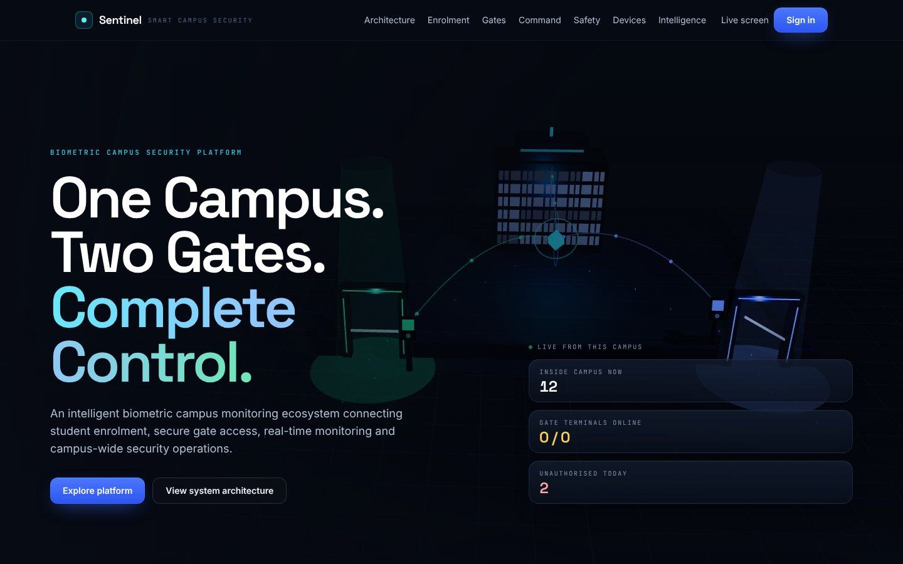

</div>

A full-stack MERN application for real-time monitoring of student entry and exit at a campus gate. Biometric terminals (eSSL X990, ADMS push) are the primary input; SAP ID entry at the gate desk is the manual fallback.

> Academic project, 3rd year B.Tech Computer Science. Mentor: Prof. Dr. Nitin Choubey.

## Screenshots

> Real captures of the running app in simulation mode (no terminal hardware), with the seed students and live scans made through the gate API: 7 day-scholar entries, 2 exits, 2 unknown IDs, and 3 hosteller exits refused because no warden approval existed.

### Admin dashboard

<p align="center">
  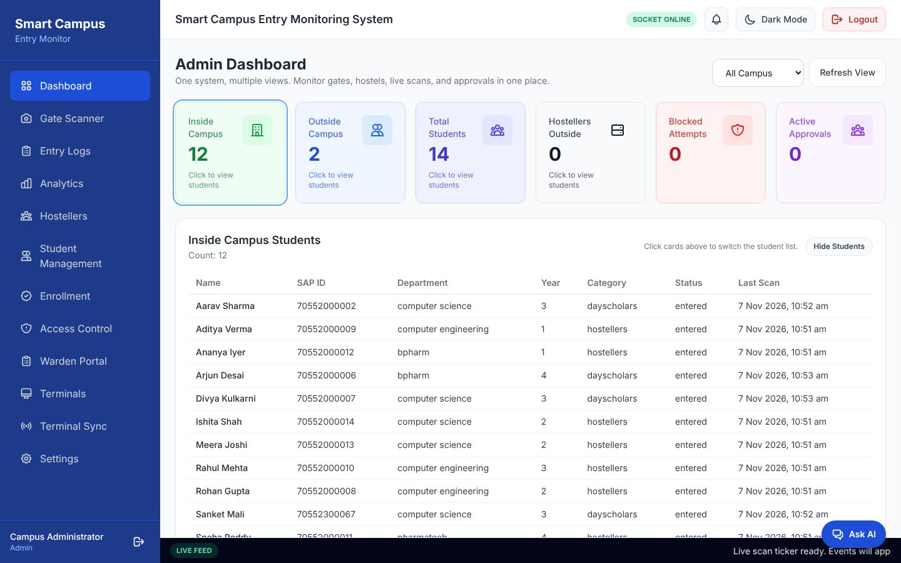
</p>

| Gate scanner (barcode camera + manual SAP ID) | Entry logs |
|:---:|:---:|
| 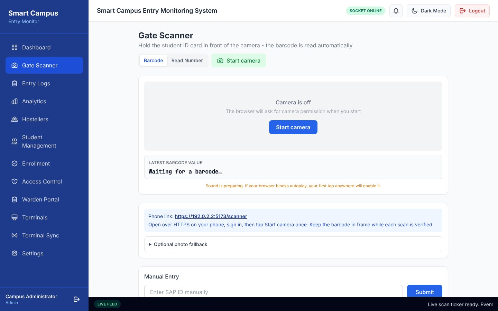 | 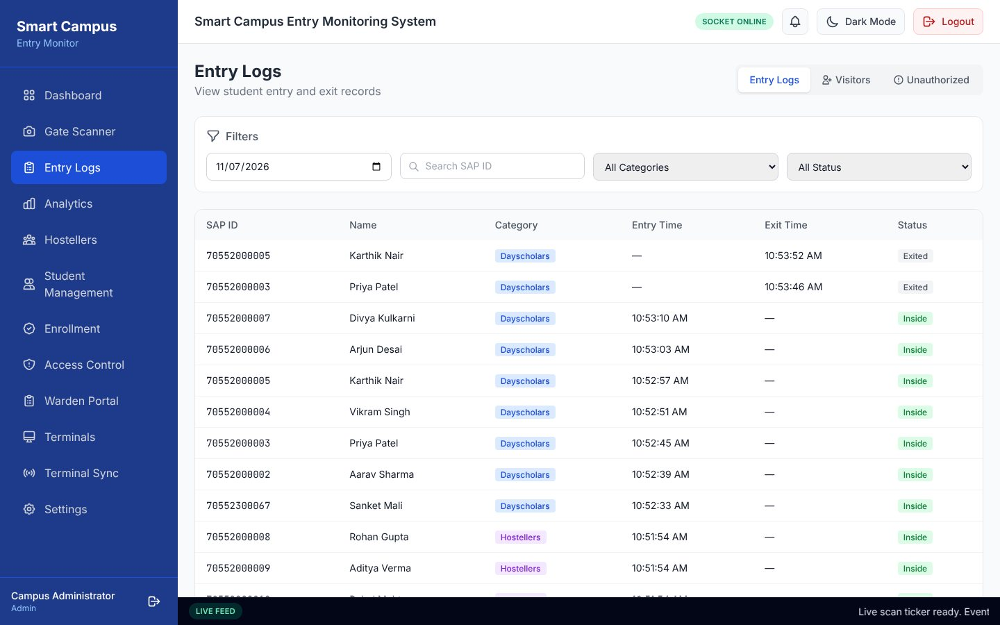 |
| **Analytics** | **Hosteller monitoring** |
| 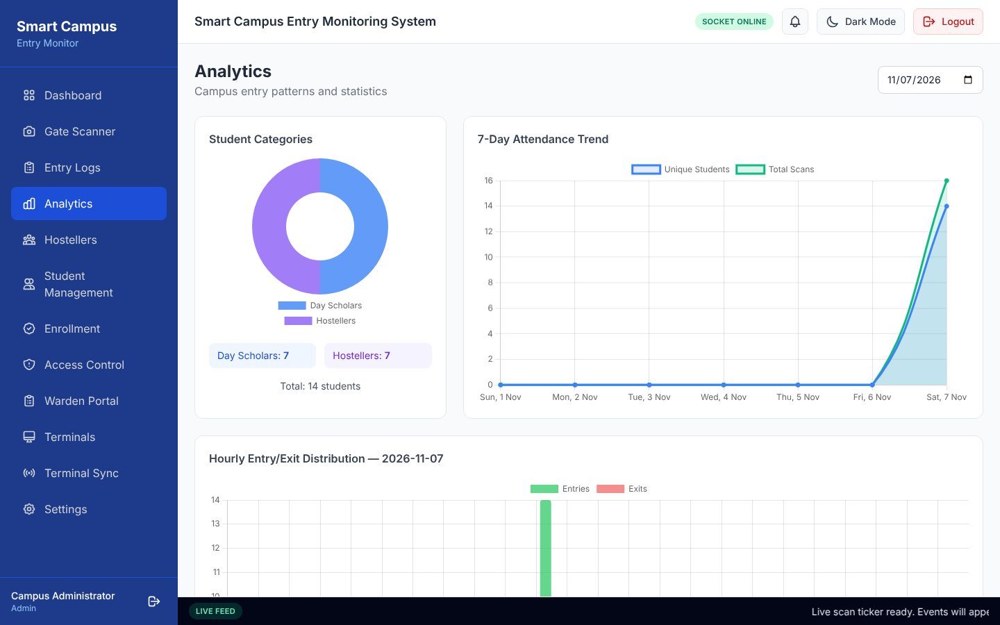 | 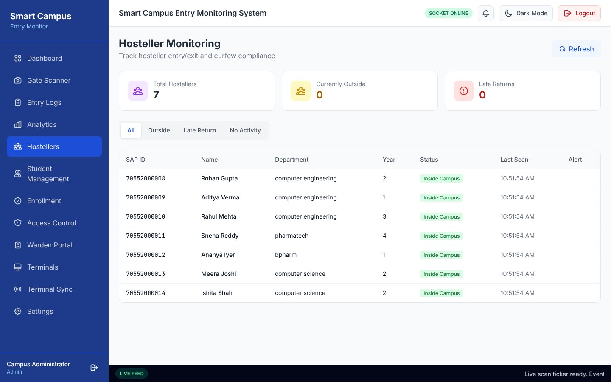 |
| **Student management (Excel upload)** | **Fingerprint enrolment** |
| 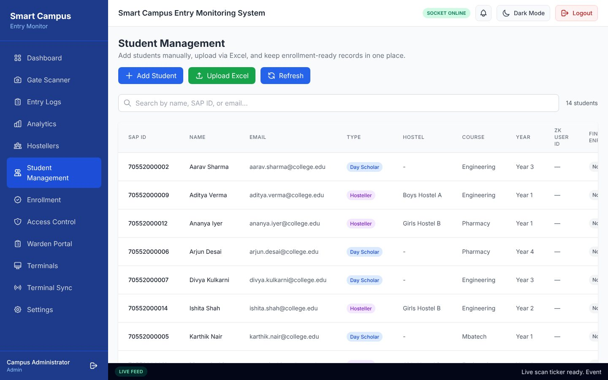 | 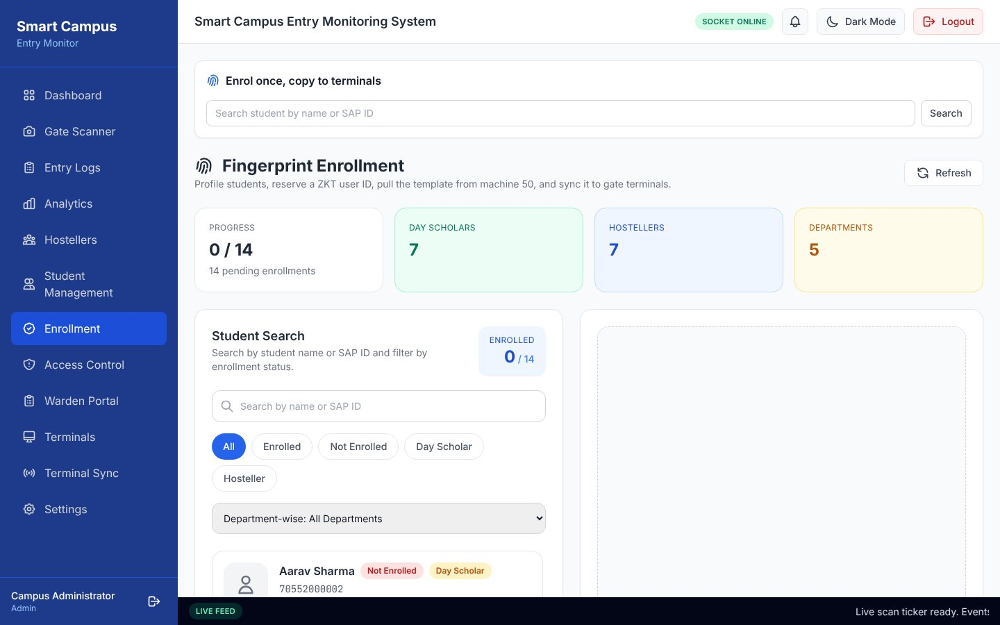 |
| **Access control (unauthorised attempts)** | **Terminal sync (3-device architecture)** |
| 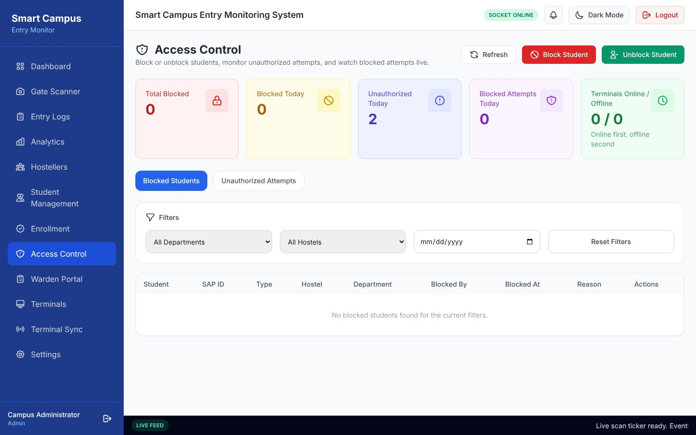 | 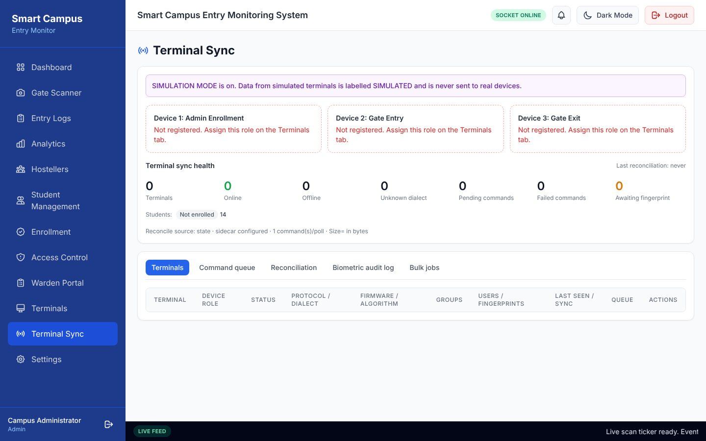 |
| **Public live dashboard** | **Settings: hostels and staff** |
| 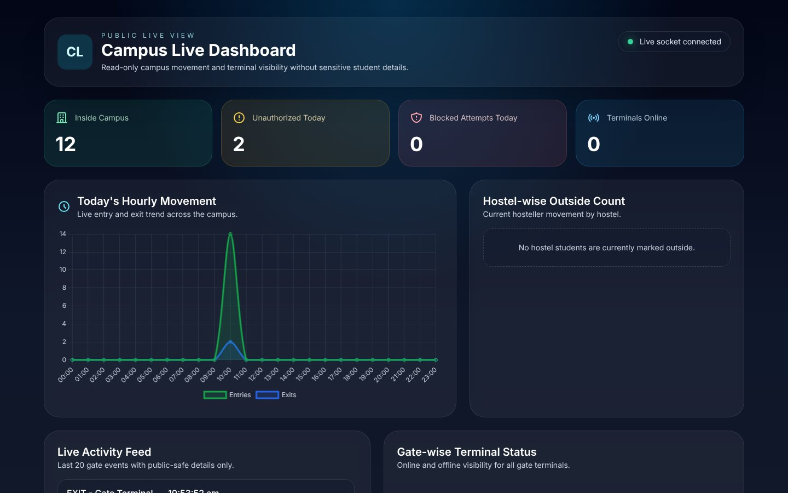 | 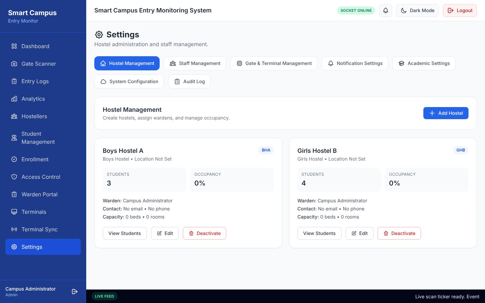 |

### Parent notifications and mobile

| Entry email (desktop) | Entry email (mobile) | Exit email (mobile) | Hosteller exit request |
|:---:|:---:|:---:|:---:|
| 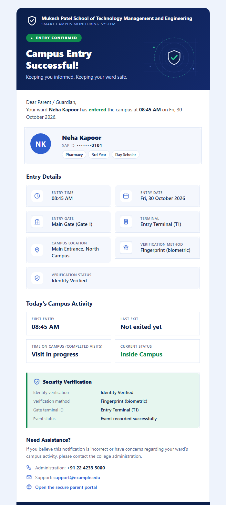 | 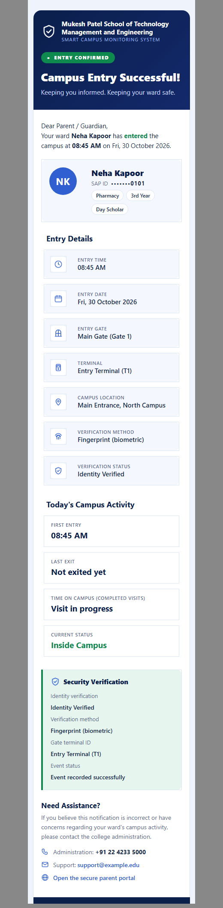 | 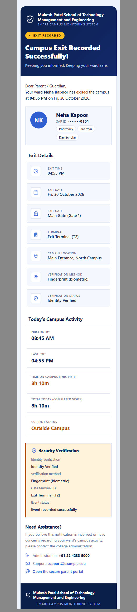 | 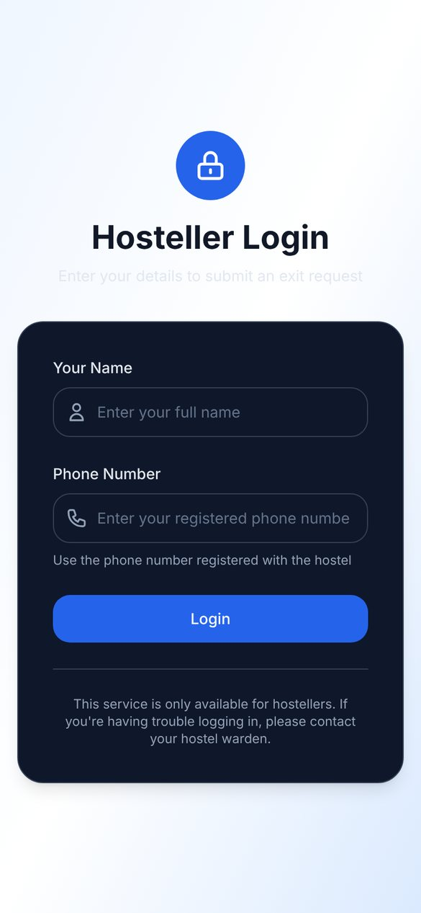 |

<details>
<summary>Login page</summary>
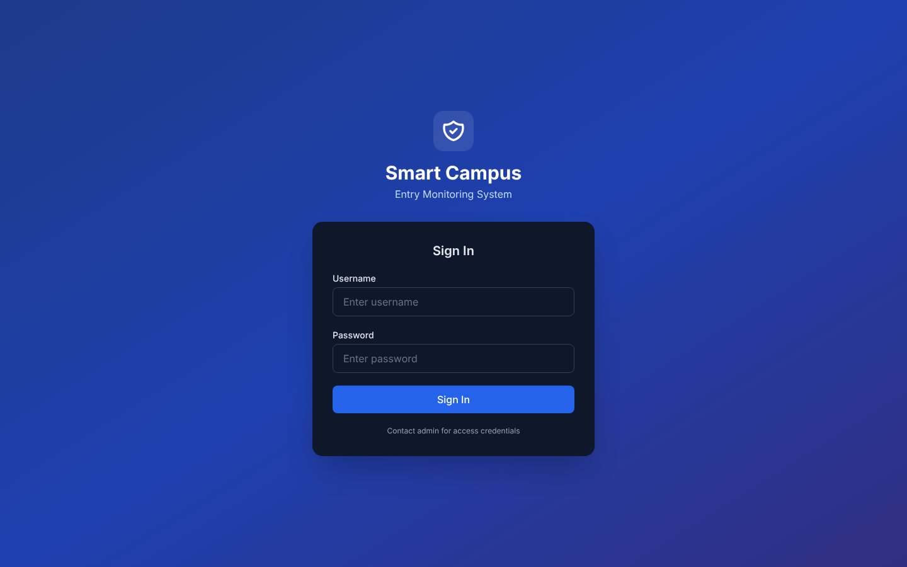
</details>

## Features

- **Entry / exit / re-entry** decided automatically from each student's state for the day; unknown IDs are logged as unauthorized attempts.
- **Day scholar and hosteller tracking**, curfew-violation flags, warden-approved exit windows, blocked-student enforcement.
- **Biometric terminal integration** with authenticated scan payloads and live terminal heartbeat.
- **Role-based access** for `admin`, `security` and `warden`; Helmet, rate limiting and request validation on the API.
- **Parent notifications** by email (Nodemailer) and SMS (Fast2SMS).
- **Dashboards and analytics** with Chart.js, live updates over Socket.IO, Excel bulk enrolment.
- **Deployment:** Dockerised frontend (Nginx) and backend; a GitHub Actions workflow builds images to Amazon ECR and deploys to ECS Fargate.

## Tech stack

| Layer | Technologies |
|---|---|
| Frontend | React 18, Vite 5, React Router 6, Tailwind CSS 3, Axios, Chart.js, socket.io-client |
| Backend | Node.js, Express 4, Mongoose 8, JWT, bcryptjs, Socket.IO, Nodemailer |
| Database | MongoDB |
| DevOps | Docker, GitHub Actions, Amazon ECR / ECS Fargate / ALB |

## Architecture

```
React (Vite) ──REST/JSON + Socket.IO──► Express API ──► MongoDB
                                        │  JWT auth + RBAC middleware
                                        └─► Notification service ──► SMTP / SMS
Biometric terminals ──authenticated scan events──► Express API
```

## Quick start

Requires Node.js and a running MongoDB.

```bash
# Backend
cd smart-campus-monitor/backend
npm install
cp .env.example .env     # set MONGO_URI, JWT_SECRET (32+ chars) and TEMPLATE_ENC_KEY
npm run seed             # resets student data and creates demo accounts
npm run dev              # API on http://localhost:5000

# Frontend (second terminal)
cd smart-campus-monitor/frontend
npm install
npm run dev              # App on http://localhost:5173
```

Generate a secret with `node -e "console.log(require('crypto').randomBytes(32).toString('hex'))"`.
Demo logins created by the seed script: `admin / admin123`, `security1 / security123`. These are for local use only; change them before any real deployment.

## Documentation

| Topic | Where |
|---|---|
| Full documentation (schema, every API endpoint, scan-logic flowchart, AWS CI/CD guide, terminal sync) | [`docs/FULL_DOCUMENTATION.md`](docs/FULL_DOCUMENTATION.md) |
| API reference | [`smart-campus-monitor/docs/API.md`](smart-campus-monitor/docs/API.md) |
| AWS deployment roadmap | [`smart-campus-monitor/docs/AWS-DEPLOYMENT-ROADMAP.md`](smart-campus-monitor/docs/AWS-DEPLOYMENT-ROADMAP.md) |
| Hardware verification and pilot checklist | [`smart-campus-monitor/HARDWARE_VERIFICATION.md`](smart-campus-monitor/HARDWARE_VERIFICATION.md), [`smart-campus-monitor/PILOT_CHECKLIST.md`](smart-campus-monitor/PILOT_CHECKLIST.md) |

## Project layout

```
smart-campus-monitor/
├── backend/     Express API (controllers, models, routes, middleware, services, tests)
├── frontend/    React + Vite app (Nginx Dockerfile)
├── sidecar/     Terminal sync helper (see its README)
├── docs/        API, deployment and hardware docs
└── docker-compose.yml
.github/workflows/deploy.yml   ECR + ECS deployment
```

## Author

Sanket Mali · [GitHub](https://github.com/Sanket1516)
Licensing: academic project, all rights reserved by the authors (see the full documentation).
